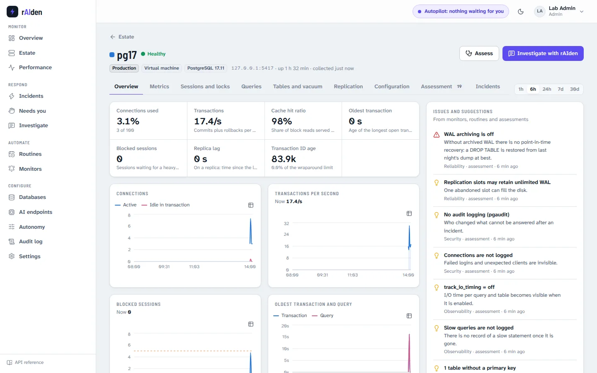

# Validation on real PostgreSQL

The tests in this repository run the console against a simulated fleet. This page is the other half: the console and
its PostgreSQL driver against real servers, PostgreSQL 13 to 18 and a streaming standby, with a real model making the
decisions. It was run on 21 October 2026 on an Azure VM that was deleted afterwards. Every problem it found is fixed in
this repository, with tests ([`test_console_driver.py`](../tests/test_console_driver.py), `test_console_api.py`) where a
server is not needed; the UI fixes were checked on the demo fleet.


## The lab

| | |
|---|---|
| Machine | Azure `Standard_D4s_v5` (4 vCPUs, 16 GiB), Ubuntu 24.04, no inbound ports: driven through Azure Run Command |
| Servers | PostgreSQL 13.23, 14.24, 15.19, 16.15, 17.11 and 18.6 from the PGDG packages, side by side, and a streaming standby of 17 |
| Workload | `pgbench` at scale 10, owned by a `migrator` role; two clients at 15 transactions per second as the `app` role |
| rAIden's login | exactly what the onboarding page asks for: `raiden_monitor`, `CONNECTION LIMIT 5`, `pg_monitor`, `pg_signal_backend`, and `pg_maintain` on 17 and 18. Not a superuser |
| Console | this repository, `pip install ".[console]"`, state in PostgreSQL (a separate 17 cluster, as in `docker-compose.yml`) |
| Model | `gpt-6.1-sol` (2026-09-29) on Azure OpenAI, Entra ID through the VM's managed identity, no API key |

Everything is reproducible with the scripts in this repository:

```bash
RAIDEN_SUB=<subscription> RAIDEN_MODEL=gpt-6.1-sol deploy/azure/up.sh   # resource group, model, VM
deploy/vm/run.sh -f deploy/vm/console-lab.sh                           # PostgreSQL 13-18, standby, roles, workload
deploy/vm/push-console.sh                                               # this code into a virtualenv on the VM
deploy/vm/run.sh '/opt/raiden-lab/venv/bin/python /tmp/raiden-console-src/tests/live/check_postgres.py \
    --servers /etc/raiden-lab/servers.json --report /var/lib/raiden-lab/driver.json'
# start `raiden console` on the VM, then tests/live/check_console.py (see its docstring)
deploy/azure/down.sh                                                    # delete everything and verify
```

## The driver: 240 checks on 7 servers, all passing

[`tests/live/check_postgres.py`](../tests/live/check_postgres.py) runs the console's PostgreSQL driver against every
server: the onboarding connection test, two collections, every read tool the AI and the live tabs use, the read-only SQL
guard, the assessment, a real lock queue that the least-privilege login has to clear, a forgotten prepared transaction,
an abandoned logical slot, and all 15 typed actions twice, once with rAIden's login and once with a superuser.

| Server | Values per collection | Assessment | Lock queue (forgotten transaction, waiting `ALTER TABLE`, writers behind it) |
|---|---|---|---|
| pg13 | 73 (no `pg_stat_statements`, no `pg_stat_wal`) | 58: 4 issues, 21 suggestions | root blocker found, 7 waiting, ended by rAIden's login, drained |
| pg14 | 76 | 67: 2 issues, 20 suggestions | root blocker found, 7 waiting, ended, drained |
| pg15 | 76 | 74: 1 issue, 18 suggestions | root blocker found, 7 waiting, ended, drained |
| pg16 | 76 | 74: 1 issue, 18 suggestions | root blocker found, 7 waiting, ended, drained |
| pg17 | 78 (with its standby) | 74: 1 issue, 18 suggestions | root blocker found, 8 waiting, ended, drained |
| pg18 | 76 | 75: 1 issue, 17 suggestions | root blocker found, 9 waiting, ended, drained |
| pg17 standby | 68 (replay lag instead of rates) | 75: 1 issue, 18 suggestions | (read-only server) |

What the login from the onboarding page may do, as PostgreSQL decided it (a superuser could do all of them):

| Action | 13 | 14 | 15 | 16 | 17 | 18 | Needs |
|---|---|---|---|---|---|---|---|
| cancel a query, end a session, end sessions by role and state | yes | yes | yes | yes | yes | yes | `pg_signal_backend` |
| `VACUUM`, `ANALYZE`, `REINDEX CONCURRENTLY` | no | no | no | no | yes | yes | `pg_maintain` (17+) or table owner |
| role timeouts and connection limits | no | no | no | no | no | no | `CREATEROLE` |
| `ALTER SYSTEM`, reload the configuration | no | no | no | no | no | no | superuser, or the 15+ grants on parameters and `pg_reload_conf` |
| roll back a prepared transaction, drop a slot | no | no | no | no | no | no | owner or superuser, `REPLICATION` |
| `CREATE INDEX CONCURRENTLY`, other DDL | no | no | no | no | no | no | table owner |

The console shows a login's grants in the connection test and on the *Databases* page, and rAIden plans with them (below).

## The console end to end: 32 checks, all passing

[`tests/live/check_console.py`](../tests/live/check_console.py) uses the console's API the way a person uses the UI.
The final run:

| Step | Result |
|---|---|
| First start, admin account | created on the setup page's API |
| AI endpoint | Azure OpenAI `gpt-6.1-sol`, Entra ID; the endpoint test answered in 2.8 s |
| Onboarding, 7 servers | connection test with the grants of each server, then the assessment with the model's summary: scores 58 to 75 |
| Monitoring | every server healthy after two collections, 40 to 51 key metrics each on the estate, history charts filled |
| Routine | Health patrol over 7 servers: one finding, on pg17: its replication slot may retain unlimited WAL (`max_slot_wal_keep_size = -1`). Correct |
| Chat | "Give me a short health summary of this server" on pg17, answered from live data: connections at 3.1%, no blocked sessions, no open transaction, one asynchronous standby streaming with about 3 ms replay lag and its slot retaining 0 bytes |
| Incident | below |

### The incident

The check builds a real lock queue on pg17: an analyst's transaction left idle after a `SELECT`, a migration's
`ALTER TABLE ... ADD COLUMN` waiting behind it for its exclusive lock, and every writer (eight sessions and the `pgbench`
clients) queued behind the `ALTER`. Then it waits, and approves what production asks a person to approve.


| Time (UTC) | Stage | What happened |
|---|---|---|
| 13:55:17 | Detected | The *Lock queue* monitor fired (blocked sessions above 5 for a minute) |
| 13:55:17 | Triage | Severity SEV2, category locks, from the metrics and the lock tree |
| 13:55:27 | Diagnose | Root cause from the lock tree and `pg_stat_activity`: the analyst's idle transaction (pid 45679) holds a lock the migration's `ALTER TABLE` (pid 45682) needs; the waiting exclusive lock request queues every writer. Plan: **cancel the waiting `ALTER TABLE`**, the least disruptive way out: no session ended, nothing rolled back but the migration statement |
| 13:55:48 | Remediate | Approved by a person (production gate). rAIden checked the lock tree again, cancelled pid 45682 at 13:55:53, and read the metrics and the lock tree: blocked sessions 11 → 0, throughput 0.7 → 96 transactions per second |
| 13:56:01 | Verify | 60-second verification window, then the metric history: the queue stayed gone |
| 13:57:12 | Harden | Three protections, approved by a person: a monitor that warns about any blocked session for a minute (applied), a lesson for the next incident on pg17, "Remove queued DDL before terminating the root reader" (applied), and, for a person because rAIden's login has no `CREATEROLE`, `ALTER ROLE migrator IN DATABASE app SET lock_timeout = '3s'` with a 60-second idle-transaction timeout for the analyst: on pg17's suggestions |
| 13:57:57 | Resolved | A 5,241-character report: summary, impact, timeline, root cause, what rAIden did, prevention. 82,167 tokens in total |

Right after the cancel the lock tree had no waiters, and `blocked_sessions` stayed at 0 from the next collection on.

## What the lab found, and what changed

| Found | How | Fix |
|---|---|---|
| The *Databases* view and the AI's `databases` tool failed on every real server with a `TypeError`: a list attribute of the driver shadowed the method. The simulator had no such attribute | driver check | renamed; the live check calls every tool |
| `CREATE INDEX CONCURRENTLY` and `REINDEX CONCURRENTLY` ran under the driver's 3-second `lock_timeout`. They wait for every older transaction, so on a busy server they failed, and a failed concurrent build leaves an INVALID index that slows every write. `IF NOT EXISTS` on top of such a leftover even reported success | driver check | 5 minutes to wait; a failed build drops its unfinished index, or says exactly which one is left and why; leftovers of an earlier attempt go first; the result is checked, not assumed. Proven on 13 to 18 with a forgotten prepared transaction in the way |
| `VACUUM` and `ANALYZE` without the privilege do not fail: PostgreSQL warns "skipping" and does nothing, and the console would have reported them as done | writing the driver check; the run confirmed it on 13 to 16 | the warning is now a refusal with PostgreSQL's own words |
| On the standby, `pg_stat_statements` counted as available: the extension is in the catalog (it came from the primary) but the library is not loaded there, so top queries failed | console run 1 | available only when it is also in `shared_preload_libraries`; the connection test says what to change; top queries explains instead of failing |
| The onboarding page asks for `CONNECTION LIMIT 5`, but collection, live tabs, AI tools and routines could together open more connections than that | setting up the lab's login | at most 3 short-lived connections per server next to the collector's; a request waits up to 30 s for one, then says why |
| The model was not told what its login may do, so it could plan role changes it cannot make | setting up the lab's login | the server brief lists the grants (in every run the model then kept role changes for a person); a plan or protection that needs a missing grant, or `ALTER SYSTEM` on a managed service, is refused while the model can still change it |
| The model put the role timeouts it could not apply into "routine" protections with free text, and the console marked them applied | console run 1 | a new kind of protection, *for a person*: it lands on the server's suggestions with the SQL; an unknown routine fails instead of passing as applied. Runs 2 and 3 used it |
| The report said "exact timestamp unavailable" for the fix | console run 1 | the report step gets the console's recorded times; the final report has the cancel at 13:55:53 |
| The model proposed a monitor with severity "warn", which the Monitors API itself refuses | console run 3 | proposed monitors are checked with the Monitors API's rules |
| The estate showed empty CPU and storage columns for servers that send neither (no Azure Monitor, no host agent), and at 1440 px they pushed the last column out of view | the screenshots | columns nobody fills are left out, with a note on where those metrics come from |
| A server added minutes earlier showed six hours of empty chart before its data, and on the incident page a three-minute incident sat squeezed against the right edge, under three overlapping labels | the screenshots | a server's charts start when it was added; the incident chart zooms to the incident, and when labels would collide a legend names the lines instead |

## Not covered here

* Managed services. Azure Database for PostgreSQL, Amazon RDS and Aurora, Cloud SQL were not part of this lab, and
  neither were Azure Monitor's platform metrics or the Azure security assessments added after it (both need a flexible
  server and the *Monitoring Reader* role; the assessments are unit-tested against the resource's documented shape). The
  driver uses only standard catalog views, but each provider's restrictions are untested here.
* TLS to the database servers: the lab ran on localhost.
* Time. The lab ran for about two hours, not weeks: retention and roll-ups are covered by unit tests only.
* Several incidents at once with a real model, notifications, and the host agent's link to the console.
* The one-console lock on a PostgreSQL state store came after this lab. Its check for the next run is
  [`tests/live/check_store_lock.py`](../tests/live/check_store_lock.py); the SQLite variant is in the tests and was tried
  with two consoles on one data directory and with the holder killed (`kill -9`).
* The web UI was driven through its API. The screenshots on this page are of the lab's console as it was; what they
  showed was fixed afterwards (the last two rows above).


